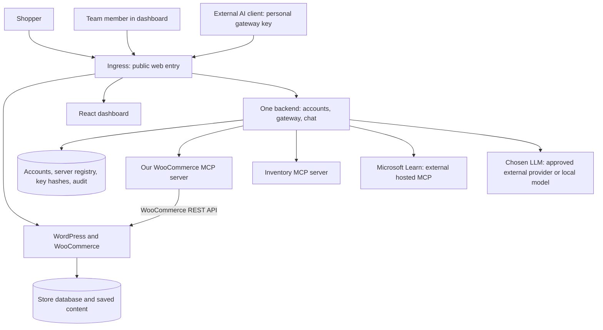

# Urumi MCP Gateway: our development blueprint

**Status:** Draft for your review. Application implementation is not approved.  
**Product source of truth:** `Urumi AI FDE Internship - Round 1_ MCP Gateway on Kubernetes.docx`  
**Working rules:** `AGENTS.md` controls our learning, review, and approval process.  
**Planning date:** 12 October 2026. **Confirmed deadline:** 20 October 2026; exact cutoff time remains open.

**Confirmed decisions:** See [docs/decisions.md](docs/decisions.md), recorded 14 October. The selected stack items and upstreams below reflect those choices; detailed design approval remains pending.

## How to read this document

Start with sections 1-4 to understand the project. Section 5 is our module-by-module work plan. Sections 6-10 hold the detailed building and checking rules. Section 11 lists the choices for your approval.

**For a quick first read:** [what we are building](#1-what-why-and-how) -> [module map](#module-map) -> [choices for review](#11-decisions-risks-and-approval). Use the remaining sections as a reference when we reach that work.

You do not need to learn everything at once. Before each module, we will explain its purpose, new terms, files, and checks. We will build it, review it, show the evidence, and wait for your approval before starting the next module.

**Labels used here:**

- **Required:** the assignment explicitly asks for it.
- **Proposed:** our suggested way of meeting a requirement; it needs your approval.
- **Optional:** extra work that waits until the required system works and you approve more scope.
- **Verified:** something we have actually observed. This blueprint describes planned work, not a working system.

## 1. What, why, and how

**WHAT:** Build one online shop and one team dashboard. The dashboard lets people use shop tools and two other sets of tools through a single gateway. People can use these tools in dashboard chat or in an external AI app.

**WHY:** Without a gateway, every person must connect to each tool server separately and handle its credentials. Our gateway gives each person one address and their own access key, while keeping the upstream credentials on the server.

**HOW:** The gateway acts like a reception desk. It checks who is asking, sends the request to the right tool server, and records what happened. Kubernetes runs the applications and replaces failed containers. Helm describes how to install the complete system.

A typical request is: **“What orders came in today?”** The AI asks the gateway for the orders tool. The gateway asks our WooCommerce MCP server. That server reads the shop's orders and returns them. The activity log records the person who asked.

Some words used below: an **API** is an agreed way for programs to ask each other for data or actions; an **audit log** is the activity history; a **hash** is a one-way fingerprint used to check a key without saving the original; a **VPS** is a rented server. An **LLM** is the language model used by our chat.

### The required scope

| Part | What we must deliver |
|---|---|
| Shop | One WordPress + WooCommerce store, checkout using a test payment method, and saved database/content that survive Pod replacement. |
| Shop tool server | Our own MCP server with five tools: list products, create product, list orders, get order, and update order status. |
| Gateway | One MCP address combining at least three upstream servers. It handles duplicate tool names and keeps working when one upstream is slow or unavailable. |
| Team dashboard | React pages for login, server status/tools, server management, invitations, individual API keys, audit records, and chat. |
| Access | Admin and member roles. Each user has their own key; keys are stored hashed and can be revoked individually. |
| Chat | A real language model calls tools through the gateway as the signed-in user. The interface shows which tools it called. |
| Kubernetes | All application services run inside local Kubernetes. Use Helm, Ingress, persistent storage, Secrets, health checks, and resource requests/limits. |
| VPS readiness | The same Helm chart supports a production-like k3s server through changed values. Supply setup, upgrade, and rollback instructions. |
| Proof and handoff | A live two-user demonstration, source code, charts, setup instructions, design/threat notes, and a private GitHub repository accessible to reviewers. |

### What waits until later

The assignment's multi-store platform is optional. We will not build store creation/deletion, one namespace per store, quotas, or automatic per-store provisioning in the core.

Other optional items are an actual VPS deployment, cert-manager TLS automation, per-tool permissions, OAuth for MCP clients, searching hundreds of tools, deploying upstream containers from the dashboard, multiple gateway replicas, rate limits, metrics, and broad security hardening. Record any completed extras in `docs/optional-items.md`; initially it says “None.”

**Important distinction:** VPS deployability is required; paying for and demonstrating a live VPS is optional. Basic controls needed to satisfy “only the gateway can call WooCommerce MCP” remain part of the core.

We also exclude real payments, a custom storefront, email delivery, billing, multiple teams, and a separate microservice for every Python file. These are proposed scope limits, not additional assignment requirements.

## 2. Kubernetes explained using Docker

You already know that Docker packages an application into an image and runs it in a container. Kubernetes manages those containers: where they run, how they find each other, when they restart, and where their saved data lives.

| Term | Simple meaning | How we use it |
|---|---|---|
| Cluster | The complete Kubernetes environment. A node is one machine in it. | A local cluster first; k3s on a VPS later if approved. |
| Pod | A small running unit containing one or more containers. Usually one app container here. | One running copy of a backend, shop, or tool server. Pods can be replaced. |
| Deployment | Instructions to keep a chosen number of app copies running and replace them on updates. | Our application workloads, usually one copy initially. |
| StatefulSet | A controller for workloads needing a stable identity and disk association. | Proposed for the two single-instance databases. It does not provide database replication by itself. |
| Service | A stable internal address, even when the Pod behind it changes. | Backend calls `woocommerce-mcp` instead of remembering a temporary Pod address. |
| Ingress | Rules that route incoming web requests to Services. | Shop and dashboard URLs; dashboard `/mcp` goes to the gateway. |
| Ingress controller | The running software that carries out the Ingress rules. | Proposed: Traefik supplied by the local k3s setup. |
| Namespace | A named group of Kubernetes resources. | One `urumi` application group and a separate group for dynamic upstream credentials. It is not a security wall by itself. |
| ConfigMap | Non-secret settings, similar to ordinary environment configuration. | Store timezone, service addresses, and timeouts. |
| Secret | A Kubernetes object for credentials with controlled access. | Database passwords, upstream credentials, and the LLM key. A Secret is not automatically encrypted at rest. |
| PersistentVolumeClaim (PVC) | An application's request for saved disk space. | Like asking for a Docker volume for WordPress uploads or a database. |
| PersistentVolume (PV) | The actual storage supplied to satisfy that request. | The disk behind a PVC. A StorageClass tells Kubernetes how to provide it. |
| Readiness probe | “Can this app serve requests now?” | Keeps traffic away from an app that is not ready. |
| Liveness probe | “Is this app stuck and in need of a restart?” | Restarts a stuck application; it should not fail merely because an optional upstream is down. |
| Requests / limits | CPU/memory Kubernetes uses to decide where an app fits; limits set usage ceilings. | Every workload gets both, based on measured local needs. |
| ServiceAccount / RBAC | An app's Kubernetes identity and its allowed Kubernetes API actions. | Only the backend needs limited access to dynamic upstream Secrets. |
| NetworkPolicy | Rules about which Pods may connect to which other Pods. | Permit the gateway to reach WooCommerce MCP and block ordinary non-gateway Pods. Enforcement must be tested. |
| Helm chart / values | The installation templates / the settings supplied to them. | One installation recipe with local and production settings. No Kustomize. |

**Workloads** run containers: the shop, databases, backend, dashboard, and our local MCP servers. **Supporting resources** describe networking, storage, access, and configuration: Services, Ingress, PVCs, Secrets, ConfigMaps, and policies. Helm installs both kinds.

A restart is not a backup. PVCs preserve data across Pod replacement; deleting the cluster or its underlying disk can still lose local data.

## 3. The proposed design

### The main request paths



Our deployed applications run inside Kubernetes. Microsoft Learn is a selected external hosted dependency; no local Microsoft Learn workload is created. The people's browsers and external MCP clients run on their own machines. A hosted LLM is an external dependency permitted by the assignment; a local LLM would need a cluster workload and sufficient hardware.

**MCP**, or Model Context Protocol, is the agreed way that an AI client discovers and calls tools. A **tool** is a named operation with defined inputs, such as `get_order(order_id)`. An **upstream** is a tool server behind our gateway. **Streamable HTTP** is the required MCP web transport. An **SDK** is a ready-made programming library; we will use one to handle MCP messages. See the [transport specification](https://modelcontextprotocol.io/specification/2025-11-25/basic/transports) when we reach M0.

The backend plays two roles: it is an MCP **server** to the external client, and an MCP **client** to each upstream. Chat also enters the gateway's checked tool-call path. Only the gateway component opens upstream MCP connections.

### Stack and tradeoffs

Python/FastAPI, React/TypeScript, PostgreSQL, k3d, and the three demo sources are confirmed; see the decision record. Other details below remain recommendations. No installed-version or runtime claim is made here.

| Responsibility | Proposed choice | Reason and alternative |
|---|---|---|
| Dashboard | React with TypeScript and Vite | React builds the pages and is required. TypeScript adds data-type checks to JavaScript; Vite builds the browser files. Plain JavaScript is a simpler alternative with fewer checks. |
| Backend, gateway, chat | Python, FastAPI, official MCP Python SDK | FastAPI handles web requests; the SDK handles MCP. One backend process keeps deployment small. Node/TypeScript is a valid alternative. |
| Shop | WordPress + WooCommerce + MariaDB | Uses the actual required shop. We configure it rather than write another commerce system. |
| Platform records | PostgreSQL | Keeps users, key hashes, server metadata, sessions, and audit records together. SQLite is lighter but ties the database file more closely to one backend instance. |
| Local Kubernetes | k3d with Docker Desktop; one k3s node initially | [k3d runs k3s in Docker](https://k3d.io/stable/), making local and VPS behavior closer. Kind/Minikube also meet the assignment; Kind needs an explicit network-policy-capable setup. |
| Deployment | One Helm chart with local and production values | Fewer moving parts than several charts for this small project. Each module owns specific template files. |
| Extra upstreams | Local sample Inventory and hosted Microsoft Learn | Confirmed. Inventory keeps warehouse examples predictable; Microsoft Learn proves external connectivity without an API key. External availability is a dependency. |
| Verification | pytest, real MCP clients, browser checks, Helm and kubectl | Checks target the behavior being built. Retrieval metrics such as recall@k do not apply to this project. |
| External user-B demo | Codex, with MCP Inspector for protocol and named-client evidence | User selected Codex. Verify its Streamable HTTP/bearer setup in M0. Also show Inspector because the assignment definition-of-done names it explicitly. |
| LLM | One tool-calling model/provider, chosen with you | Hosted models need connectivity and may cost money; a local model needs more RAM/CPU or GPU. No paid choice is assumed. |

Before implementation, M0 records compatible package/image versions and proves the chosen client, SDK, and model can perform the required tool loop. Do not rely on floating `latest` image tags.

### Three upstreams, kept deliberately small

| Server | Tools/data | Purpose and independent check |
|---|---|---|
| `woocommerce` | `list_products`, `create_product`, `list_orders`, `get_order`, `update_order_status` | Required custom server. Check all five against a simulated shop API before real integration. |
| `inventory` | `lookup_sku(sku)` using a small checked-in JSON fixture | Returns warehouse/availability data. Check known and unknown SKUs. Clearly label it sample data, not synchronized shop stock. |
| `microsoft-learn` | Discover the hosted server's documentation search/fetch tools using MCP | Confirmed external source. Independently list/call discovered tools; no credentials required. Record actual schemas and connectivity evidence. |

The extra two have separate Streamable HTTP MCP endpoints. Inventory runs inside our cluster; Microsoft Learn is hosted externally. Controlled test servers expose duplicate `service_info` names to prove collision handling without assuming that Microsoft Learn offers that tool.

Example user-B prompt: **“Find SKU DEMO-001 in our shop, tell me its price, and check its warehouse availability.”** A successful answer must use `woocommerce` and `inventory` through the gateway. Two invented answers or two manual Inspector calls do not prove this prompt works. Separately call a discovered Microsoft Learn tool through the gateway to prove real external connectivity.

## 4. How we will work

Our sequence is **specification -> review -> design -> review -> implement one module -> review -> test -> user approval**. Small developer checks can run during implementation; the acceptance test report comes before we move on. Use Plan mode for feature planning when it is available.

Each module gets a short design explaining WHAT, WHY, HOW, file ownership, inputs/outputs, and checks. Subagents may review specifications, designs, and implementation independently. They do not approve work on your behalf or start later modules without your approval.

**Independent testing** means a module can be checked with a predictable stand-in for an unfinished dependency. For example, the gateway can call a small test MCP server that deliberately succeeds, times out, or fails. It does not need the real store to prove its routing logic.

A **contract** is the agreed shape of a request and reply. A **fixture** is prepared sample data or a test service. A **gate** is the point where we review evidence and ask you to approve the next step.

**Integration** means connecting the real modules. That happens in M10 after their individual gates. A unit check using fake data must never be described as proof of real shop behavior.

All module files below are proposed future paths. Creating this blueprint does not create those application files.

### Module map

| Module | Plain-language job | Depends on approved work |
|---|---|---|
| M0 | Agree on the contracts and settle technical choices | This blueprint approved |
| M1 | Prepare our Kubernetes playground | M0 |
| M2 | Run the shop and save its data | M1 |
| M3 | Write the five shop tools | M0; use shop API fixtures |
| M4 | Build Inventory and check hosted Microsoft Learn | M0 |
| M5 | Build accounts, keys, server records, and activity records | M0; isolated database/Secret tests |
| M6 | Build gateway discovery, routing, and failure handling | M0; use M5 contracts and test upstreams |
| M7 | Build the AI tool loop | M0; use the gateway contract and test gateway |
| M8 | Build the dashboard pages | M0; use API fixtures |
| M9 | Prepare the Helm release and operating instructions | Reviewed M1-M8 artifacts |
| M10 | Connect everything and demonstrate the complete system | All earlier gates approved |

We follow this numbered order for learning. Independent reviews can happen in parallel. A dependency in this table allows using an agreed contract; it does not permit early wiring of the real modules.

## 5. The modules we will build

For each module, its **owner** is the implementer assigned to that module; the module ID below owns its listed files. A reviewer checks the result, and you approve the gate. This avoids two implementers changing the same files without coordination.

### M0. Shared contracts and final design

**WHAT:** Agree on what each part accepts and returns. **WHY:** Separately built modules must agree on their messages. **HOW:** Write small example requests, replies, and errors, then check the key library/client choices with disposable examples.

- **Owns:** `contracts/mcp-tools.md`, `contracts/platform-api.md`, `contracts/identity-and-audit.md`, `tests/fixtures/`, `docs/decisions.md`, and dependency lock files.
- **Input -> output:** Assignment and approved choices -> agreed tool schemas, API examples, identity object, audit format, version list, and approved module designs.
- **Design tasks:** Confirm local ports/resources, three upstreams, client, model, login/invites, chat identity, Secret permissions, timeouts, and store timezone. Record “today” as midnight to now in that timezone, converted consistently for WooCommerce queries.
- **Independent check:** A disposable Streamable HTTP client/server proves initialize, list, call, error handling, and the chosen authentication header. Inspect chosen SDK session behavior. Check the chosen LLM can request a tool with valid arguments using a fixture.
- **Gate/evidence:** `docs/evidence/m0/` contains exact commands, sample transcripts, choices, and unresolved gaps. Product code begins only after this design review is approved.
- **Excluded:** Actual gateway, real store integration, and production deployments.

### M1. Kubernetes foundation

**WHAT:** Prepare the place our apps will run. **WHY:** We need stable networking and saved storage before deploying the shop. **HOW:** Create the approved local cluster and a minimal Helm skeleton; use a disposable example workload to demonstrate Kubernetes behavior.

- **Owns:** `infra/local/k3d.yaml`, `deploy/charts/urumi/Chart.yaml`, common Helm helpers, namespace/policy foundations, and `docs/local-cluster.md`.
- **Input -> output:** Approved local setup -> a cluster with working Ingress, internal DNS, storage provisioning, and enforced NetworkPolicies.
- **Independent check:** Show node/Pod status; reach a sample page through its local hostname; verify a sample PVC survives Pod replacement; allow a test source Pod and deny another using a policy.
- **Gate/evidence:** `docs/evidence/m1/` shows exact setup commands, probe/resource settings, access checks, and Windows hostname setup. No claim that policies work from YAML alone.
- **Excluded:** Real store/backend deployment and changing host settings without discussing any required privileges.

### M2. The persistent WooCommerce store

**WHAT:** Install one working online shop. **WHY:** This is the real data source for the AI tools. **HOW:** Run WordPress/WooCommerce with MariaDB, connect their persistent disks, and expose the shop through Ingress.

- **Owns:** `deploy/charts/urumi/templates/store/`, `scripts/store-setup.ps1`, and `docs/store-setup.md`. Pin the WooCommerce plugin version in a reproducible setup procedure; do not depend on an undocumented manual installation.
- **Input -> output:** Secret references, storage settings, domain, timezone, and seed product -> a working shop and an order visible in WooCommerce admin.
- **Independent check:** Add product to cart and complete COD checkout. Save an uploaded product image. Replace WordPress and MariaDB Pods separately and show the product, order, and image remain.
- **Credential preparation:** Create a dedicated WooCommerce REST integration credential with the permissions needed for the five tools. Store it as a Kubernetes Secret. Record setup/rotation steps without key values.
- **Gate/evidence:** `docs/evidence/m2/` contains storefront/admin screenshots, product/order IDs, upload proof, PVC status, and before/after restart output.
- **Excluded:** MCP integration, real payments, multiple stores, and custom storefront styling.

### M3. Our WooCommerce MCP server

**WHAT:** Write the five required shop actions ourselves. **WHY:** The gateway speaks MCP; WooCommerce exposes a shop API. This server translates between them. **HOW:** `server.py` registers MCP tools; `tools.py` validates input; `woocommerce_client.py` makes REST requests.

- **Owns:** `services/woocommerce_mcp/server.py`, `tools.py`, `woocommerce_client.py`, `schemas.py`, its Dockerfile, `tests/woocommerce_mcp/`, and `templates/woocommerce-mcp/` in the Helm chart.
- **Input -> output:** Typed MCP arguments -> WooCommerce REST request -> bounded product/order data or a clear error. REST was chosen because it avoids direct database access and uses WooCommerce's own operations.
- **Independent check:** A real MCP client talks to this server while a fake REST server supplies shop responses. Check all five tools, bad inputs, missing order, store authentication failure, pagination, timeout, and permitted order statuses. No automatic retry of writes after an uncertain timeout.
- **Gate/evidence:** `docs/evidence/m3/` includes discovered tool schemas and successful/failing calls. Real WooCommerce compatibility remains an explicit M10 check.
- **Excluded:** Gateway, team access, chat, and installing an existing WooCommerce MCP plugin/server.

### M4. Inventory and external-server compatibility

**WHAT:** Provide the sample warehouse helper and check our selected hosted server. **WHY:** The gateway needs three independent tool sources, including a real external endpoint. **HOW:** Write one small Inventory MCP server; use an isolated MCP client to discover and call Microsoft Learn before final gateway wiring.

- **Owns:** `services/sample_mcps/inventory.py`, `data/`, its Docker build files, `tests/sample_mcps/`, Helm `templates/sample-mcps/`, and `docs/external-mcp.md`. No Shipping implementation or hosted Microsoft Learn deployment is needed.
- **Input -> output:** Inventory SKU -> sample warehouse/availability result; external MCP request -> discovered tools and actual documentation results.
- **Independent check:** List/call Inventory tools; check known/unknown SKUs and validation. Independently list/call Microsoft Learn over Streamable HTTP and save its real schemas. Use controlled duplicate-name fixtures for M6 collision tests.
- **Credential check:** Controlled servers cover missing, incorrect, and valid bearer/custom-header credentials. Microsoft Learn is unauthenticated and cannot prove those cases; a real keyed hosted-server check is separate evidence if performed.
- **Gate/evidence:** `docs/evidence/m4/` distinguishes real external results from controlled fixtures. Cross-server natural-language and real gateway registration tests remain M10 checks.
- **Excluded:** Stock synchronization, shipping purchases, Microsoft Learn hosting, and provider-specific gateway branches.

### M5. Accounts, keys, registry, and audit storage

**WHAT:** Save who people are, which upstreams exist, and what actions happened. **WHY:** Routing alone cannot provide team access or accountability. **HOW:** Small backend modules expose contracts for identity, server metadata, Secret access, and audit persistence.

| Submodule / owned files | Responsibility | Independent gate |
|---|---|---|
| `backend/identity/auth.py`, `members.py`, `api_keys.py` | Login, invite redemption, roles, issuing/hashing/revoking keys | Admin/member checks; one-time invite; own-key isolation; hash inspection; revoked key rejected. |
| `backend/registry/servers.py`, `secret_store.py` | Add/edit/disable/remove upstream metadata and manage credential references | Admin-only changes; no returned credential; Secret failure leaves a clear recoverable result. |
| `backend/audit/records.py` | Save caller, server, tool, start time, duration, and result | Success, failure, timeout, and denied examples persisted with redaction. |
| `backend/db/models.py`, `migrations/` | Store platform records in PostgreSQL | Clean database setup, constraints, and persistence after database restart. |

- **Also owns:** Relevant API routes, `tests/platform/`, and Helm templates for the platform database and dynamic Secret access.
- **Input -> output:** Authenticated requests and operation results -> safe account/server/audit records; a raw personal key appears only once at issuance.
- **Independent check:** Test against isolated PostgreSQL and a Kubernetes Secret adapter test setup. No real MCP server is needed. Bootstrap the first admin from a Secret-backed procedure, without a default password in source.
- **Gate/evidence:** `docs/evidence/m5/` contains the four submodule results and role/ownership checks. Revoke one of a user's two keys and show the other remains valid.
- **Excluded:** Actual upstream discovery/routing, email sending, OAuth, and per-tool permissions.

### M6. Gateway discovery and routing

**WHAT:** Offer one MCP endpoint for all enabled upstream tools. **WHY:** Every user should need only the gateway URL and their own key. **HOW:** Authenticate -> get allowed server records -> list or route tools -> record the outcome -> return the result.

- **Owns:** `backend/gateway/server.py`, `discovery.py`, `router.py`, `upstream_client.py`, and `tests/gateway/`. The shared entry point is `invoke_tool(principal, tool_name, arguments)`.
- **Input -> output:** Verified identity plus MCP request -> combined tool list or one routed result. A `principal` is the server-verified user identity, not an ID trusted from request text.
- **Independent check:** Use contract-compatible identity/registry/audit stand-ins and test MCP servers. Cover duplicate names, pagination, bearer/header credentials, no credentials, bad credentials, disabled/removed servers, unknown tools, protocol errors, timeouts, and recovery.
- **Security check:** Recheck the key and server state for every call, including existing sessions. Ensure gateway credentials are never copied to upstream headers. Verify each call produces one audit attempt and outcome through the audit contract.
- **Gate/evidence:** `docs/evidence/m6/` contains protocol transcripts and measured failure-isolation results. Real database/upstream wiring waits for M10.
- **Excluded:** UI, LLM reasoning, multiple gateway replicas, and tool-specific access policies.

### M7. Chat tool loop

**WHAT:** Turn a person's question into tool calls and a readable answer. **WHY:** The assignment requires a working agent, not only manual tool buttons. **HOW:** Give the model the current tool list, execute its requested tools through the gateway, return results to the model, then show its answer and tool activity.

- **Owns:** `backend/chat/agent.py`, `llm_client.py`, `prompts.py`, and `tests/chat/`.
- **Input -> output:** Message plus server-verified login identity -> final answer and a visible list of actual calls/results.
- **Identity proposal:** Chat is inside the same backend. It passes the verified user to the gateway's shared entry point. It never tries to recover a raw API key from a hash and never connects to an upstream itself. External MCP requests use that same entry point after API-key authentication.
- **Independent check:** Use a fake gateway for create-product, today's-orders, cross-server, failed-tool, and disabled-tool conversations. Use a real selected LLM once against that fake gateway to prove provider tool calling. Bound tool rounds; proposed maximum is eight per message, then return a clear stop message.
- **Gate/evidence:** `docs/evidence/m7/` shows requested versus executed tools, propagated identity, and real-provider evidence. This is not yet proof of real shop changes.
- **Excluded:** Autonomous background tasks, long-term conversation memory, model-quality benchmarking, and direct upstream access.

### M8. React dashboard

**WHAT:** Give admins and members usable pages. **WHY:** Server management, personal keys, chat, and audit evidence must be visible. **HOW:** React pages call backend APIs using the signed-in session.

- **Owns:** `frontend/src/pages/Login.tsx`, `Invite.tsx`, `Servers.tsx`, `Members.tsx`, `Keys.tsx`, `Audit.tsx`, `Chat.tsx`, `frontend/src/api.ts`, frontend tests/build, and Helm `templates/dashboard/`.
- **Input -> output:** API responses and user actions -> server status/tool list, management forms, once-only key display, chat tool activity, and audit tables.
- **Independent check:** Use API fixtures in a real browser. Exercise admin and member views, invitation redemption, loading/errors, all three server statuses, key creation/revocation, and chat showing called tools. Browser network inspection confirms responses do not contain upstream credentials.
- **Gate/evidence:** `docs/evidence/m8/` includes screenshots and interaction results. Hiding an admin button is not authorization; M5 must reject unauthorized API calls too.
- **Excluded:** Live backend wiring, large design systems, analytics dashboards, and optional multi-store UI.

### M9. Release package and operating guide

**WHAT:** Make installation and operation repeatable. **WHY:** Reviewers must be able to run the project and understand the local-to-VPS path. **HOW:** Assemble the reviewed Helm templates and configuration values, container-build instructions, and runbooks without starting the combined application yet.

- **Owns:** Final `values.yaml`, `values-local.yaml`, `values-prod.yaml`, `values.schema.json`, Helm `templates/backend/`, the backend Dockerfile, `scripts/build-images.ps1`, `README.md`, `docs/system-design.md`, `docs/threat-model.md`, `docs/operations.md`, and `docs/optional-items.md`.
- **Input -> output:** Approved component artifacts -> a renderable chart, versioned image/build definitions, secret-free settings, and local/k3s setup instructions. M10 builds the combined backend image after its real wiring exists.
- **Independent check:** Lint and render the same chart with both values files; inspect public routes, PVCs, probes, resources, Secret references, policies, and enabled workload set. Every component contributes its health endpoints and container definition before this gate.
- **Gate/evidence:** `docs/evidence/m9/` contains chart checks and documented bootstrap, image import/pull, domain, storage, backup, upgrade, and rollback steps. A template render is not a live VPS deployment.
- **Excluded:** Combined runtime acceptance and VPS purchases/deployment without approval.

### M10. Final integration and acceptance

**WHAT:** Connect the real modules and prove the assignment works. **WHY:** Passing separate tests does not prove the full user journey. **HOW:** One application entry point wires the backend modules; Helm deploys the workloads; end-to-end checks drive the real user flows.

- **Owns:** `backend/main.py`, `backend/orchestrator.py`, `scripts/demo.ps1`, `tests/e2e/`, `docs/demo-checklist.md`, and `docs/evidence/m10/`.
- **Wiring:** `main.py` starts the web/MCP application. `orchestrator.py` creates the real database, identity, registry, audit, gateway, and chat dependencies. It contains wiring, not another copy of their business logic. Helm is the deployment orchestrator.
- **Input -> output:** Approved modules, real Secret references, users A/B, and demo data -> a clean local installation and observed acceptance evidence.
- **Integration tasks:** Point Woo MCP at the real shop; register it automatically as the first upstream; register Inventory/Microsoft Learn; connect PostgreSQL, UI, gateway, and real LLM. Reconcile built-in registration by stable ID on restart so it does not duplicate or overwrite admin changes.
- **Check:** Run every step in section 9, including direct-access denial, real store persistence, per-user audit, revocation in an existing session, disable, outage, and recovery. Remove test substitutes for the real shop, gateway, and LLM. Retain the approved sample Inventory data; Microsoft Learn results must come from the actual remote endpoint.
- **Gate:** Only call the core complete when all required checks pass. Submit the evidence and limitations for your approval before recording/final handoff or proposing optional work.

## 6. Rules for requests, identity, and credentials

### Accounts and permissions

**Confirmed login approach:** Local email/password accounts with an HTTP-only session cookie. Admin creates a single-use, expiring invitation link to share manually; the member sets a password. Email delivery is outside scope. Passwords use an established password-hashing library; invitation/session tokens are not stored as plaintext. Cookie security, request-origin checks, and logout are part of the M5 design.

| Action | Admin | Member |
|---|---|---|
| Use enabled tools and dashboard chat | Yes | Yes |
| View server status and available tools | Yes | Yes, without credential fields |
| Add/edit/disable/remove servers | Yes | No |
| Invite/manage members; issue/revoke their keys | Yes | No |
| Generate/revoke own keys | Yes | Yes |
| See audit records | All team records | Own records only, proposed |
| Read another person's keys, sessions, or private chat | No plaintext retrieval | No |

In the core, members can use all enabled tools, including product creation and order-status updates. Restricting particular tools to admins is an optional extension. We must explain that members can cause actions using a shared upstream credential even though they cannot see it.

### Personal gateway keys

Generate a long random key; show the raw value only once. Store its lookup identifier, cryptographic hash, owner, creation time, and revocation time. Authentication compares the submitted key with the stored hash using an established safe comparison. Never log it or place it in a URL.

Recheck revocation for each request/tool execution; an old MCP session must not bypass it. A revoked key's next call fails without an upstream call. The signed-in dashboard session is a separate credential: revoking an external API key does not automatically log out that user. Disabling a user, if offered, invalidates that user's access across paths.

### Where secrets live

| Credential | Used by | Storage / visibility |
|---|---|---|
| Store DB password | WordPress and MariaDB | Pre-created Kubernetes Secret; no source-code value. |
| WooCommerce REST credential | WooCommerce MCP only | Pre-created Kubernetes Secret mounted into its Pod. |
| Optional upstream header/bearer credential | Gateway only | Dynamic Secret; registry stores the reference and auth mode. |
| Platform DB password | Backend and PostgreSQL | Pre-created Kubernetes Secret. |
| LLM provider key | Backend chat component only | Pre-created Kubernetes Secret; never in a prompt or frontend bundle. |
| Personal gateway key | User presents it to gateway | Raw key held by user; only its hash is stored in the platform database. |

An admin may enter an upstream credential in a protected form. The response contains only “credential configured,” never the saved value. This does not promise that the administrator who originally supplied a credential has never known it.

**Dynamic Secrets proposal:** Keep them in `urumi-upstream-secrets`, separate from database/provider credentials in `urumi`. Grant the backend ServiceAccount only the required Secret get/create/update/delete actions there. Kubernetes permission to create Secrets cannot be limited by a future object name using `resourceNames`; the namespace is the permission boundary ([Kubernetes RBAC documentation](https://kubernetes.io/docs/reference/access-authn-authz/rbac/)). The backend must have no cluster-admin role. An alternative encrypted database design adds key management and needs separate approval.

Define clear behavior when a Secret write fails: do not report a usable connection, do not leak the submitted credential in an error, and allow the admin to retry. Removing a server removes its credential reference and owned dynamic Secret; it does not delete the upstream application.

### Gateway behavior

- **One endpoint:** Proposed `/mcp` on the dashboard host. MCP initialize, tool listing, calls, headers, and session lifecycle use the tested SDK. Support Streamable HTTP; do not substitute the old SSE-only transport.
- **External compatibility:** Register any compatible Streamable HTTP endpoint by URL with no credential, static bearer token, or a named API-key header. Discover tools and schemas rather than hardcode providers. M6 tests authentication and redaction with controlled endpoints; M10 proves Microsoft Learn registration and actual remote calls. Browser-based OAuth remains optional.
- **Tool names:** Prefix each tool with an immutable unique server slug, for example `woocommerce__list_orders` and `inventory__service_info`. Keep an explicit public-name-to-server/tool mapping. M0 defines escaping, length limits, and collision checks for names supplied by arbitrary registered servers.
- **Discovery:** Read all pages of each enabled server's tool list. Discover independently with bounded concurrency/timeouts so one failed server cannot block the rest. Preserve the last successful list for a temporarily unreachable server and display its status; before first successful discovery, show its error without inventing tools.
- **Call routing:** Resolve the stored mapping, check user/key/server state, start the audit attempt, call that upstream with its configured credential, then record the outcome. Never pass the user's gateway key or session cookie upstream.
- **Timeouts:** Proposed discovery deadline is 3 seconds per server; tool-call deadline is 10 seconds. Validate these locally. Healthy calls must not wait behind an unreachable server. Writes are not automatically retried after uncertain failure.
- **Disable/edit/remove:** Invalidate relevant connections and tool caches. Disabled/removed tools disappear on fresh discovery and are rejected even when called by an old name. Chat refreshes its tool list for each message and rechecks before execution. Use tool-list change notifications when supported; document the external client's refresh/reconnect behavior.
- **Status:** `Connected` means the last MCP check succeeded; `Unreachable` means it failed; `Disabled` means an admin switched it off. Include check time and a safe reason. Proposed polling is every 5 seconds, with the unreachable state visible within 15 seconds of a sustained failure.
- **Sessions:** Prefer the simplest SDK-supported session model for one gateway replica. If stateful, bind sessions to the authenticated caller, revalidate on each request, and never reuse one user's client session for another. Record reconnect behavior after backend restart.

### Audit behavior

Save one record per attempted tool execution: request ID, verified user ID, optional key ID, server ID, original/public tool name, start timestamp in UTC, duration in milliseconds, and outcome. Outcomes include success, error, timeout, and denied. Record a redacted error summary, not full credentials or unnecessary customer payloads.

Create the attempt before dispatch; if the audit database is unavailable, reject execution with a clear error rather than silently perform an unrecorded write. Finalize the outcome after the response. An interrupted attempt may have an unknown result; do not label it successful or retry a write automatically.

For a revoked key that still matches a stored record, attribute the rejection to that key's owner. For a random invalid key, the user is unknown; never trust a claimed user ID. An unknown tool may likewise have an unknown server. The dashboard must display these cases honestly.

## 7. Kubernetes and Helm deployment plan

### File/resource ownership

```text
backend/                      # M5-M7 logic; M10 wiring
frontend/                     # M8 React dashboard
services/woocommerce_mcp/      # M3 custom shop tools
services/sample_mcps/          # M4 sample inventory
contracts/                    # M0 agreed requests and replies
tests/                        # Separate module checks and final e2e checks
infra/local/                  # M1 local cluster configuration
deploy/charts/urumi/
  Chart.yaml                  # Chart identity
  values.yaml                 # Shared non-secret defaults
  values-local.yaml           # Local hostnames, images, storage, resources
  values-prod.yaml            # VPS examples; never real credentials
  values.schema.json          # Validation of required settings
  templates/
    store/                    # M2 WordPress, MariaDB, Services, PVCs
    woocommerce-mcp/           # M3 workload and internal Service
    sample-mcps/               # M4 Inventory workload and internal Service
    platform-db/              # M5 PostgreSQL, Service, PVC
    access/                   # M5 ServiceAccount/RBAC for Secret namespace
    dashboard/                # M8 static React web server
    backend/                  # M9 deployment of the backend artifact
    networking/               # M1 foundation; M9 final routes/policies
scripts/                      # Setup/build/demo helpers; no business logic
docs/                         # Design, threat model, operations, evidence
```

The chart can enable only the component under test during module work. The final local and production values enable the full required core. Component owners provide their templates; M9 coordinates shared values and route/policy changes after review.

### Public and private connections

| Address/service | Who may reach it | Enforcement/check |
|---|---|---|
| `store.urumi.test` | Shopper and store administrator through Ingress | Storefront works; WooCommerce admin still requires its login. |
| `dashboard.urumi.test` | Team users through Ingress | `/` serves React, `/api` reaches backend, `/mcp` reaches gateway; login/key required where appropriate. |
| WooCommerce MCP | Gateway backend only among application Pods | Internal `ClusterIP` Service, no Ingress/NodePort, targeted NetworkPolicy. Test a denied non-gateway Pod. |
| Inventory | Gateway backend in final deployment | Internal Service and targeted ingress policy. |
| Microsoft Learn | Gateway backend over outbound HTTPS | External hosted Streamable HTTP endpoint; no local Service or Pod. Record its actual connectivity and failure behavior. |
| MariaDB | WordPress | Internal Service and targeted policy. |
| PostgreSQL | Backend | Internal Service and targeted policy. |

The WooCommerce REST API belongs to the shop; its required authentication and permissions still apply even though the storefront is public. Kubernetes administrators can inspect Pods and credentials; this plan does not claim to isolate the cluster owner from their own cluster.

**Local domains:** Proposed hosts-file entries map both `.test` names to `127.0.0.1`; the k3d configuration maps an available local port to Ingress. Use the same documented port consistently in the shop URL, browser, and MCP client. Confirm Windows privileges and port conflicts in M1. Do not require public DNS to run locally.

### Persistence, health, and configuration

- Separate PVCs hold MariaDB data, PostgreSQL data, and WordPress `wp-content` uploads/plugins/themes. WordPress configuration is reproducible from the image, values, and Secrets. Test both database records and uploaded files.
- Use one replica for stateful components initially. The WordPress update strategy must avoid two writers on a single-writer volume; define that explicitly in its template. Database StatefulSets use their own disks.
- Every workload has readiness/liveness probes and CPU/memory requests/limits. Databases use appropriate database checks; static frontend uses an HTTP check; Python services expose health endpoints. Add startup probes where slow initialization needs them.
- Backend liveness checks its own process. A dead upstream must not trigger backend restart or remove the gateway from service for healthy upstreams. Database failure can make operations unavailable and must be reported clearly.
- Do not invent production sizing. M1 inventories machine resources; each module records measured local use; M9 sets explicit, documented local and production starting values.
- Bootstrap credentials outside source and secret-free Helm values. Values reference existing Secret names. Do not pass secrets using `--set` into shell history or Helm release configuration.
- Before “gateway-only” is accepted, demonstrate NetworkPolicy enforcement in the selected cluster. An internal Service or a namespace alone is insufficient.

### Local versus production-like VPS

| Setting | Local | VPS/k3s |
|---|---|---|
| Chart/application code | Same chart and application images | Same chart/code; no production-only template fork |
| Image delivery | Build/import into the local cluster | Versioned images in an accessible private registry; pull credentials in Secret |
| Domain | Local `.test` names and chosen port | Real DNS names pointing at the server |
| Ingress | Approved local controller/class | Controller/class selected in values |
| Storage | Local provisioner's StorageClass | VPS StorageClass, capacities, disk location, and backup plan documented |
| Credentials | Local test values in pre-created Secrets | Provision through a documented secure process, with limited access |
| Web encryption | Loopback-only local development may use HTTP | HTTPS for network access carrying credentials; supplied certificate is sufficient, cert-manager automation is optional |
| Capacity | Measured local requests/limits | Values adjusted to actual VPS resources |

The system's required portability will be checked through one chart, both rendered configurations, pinned artifacts, and a usable k3s runbook. A second clean local k3s-based install helps check portability but is not proof of public VPS DNS, TLS, storage, or firewall behavior. Report live VPS runtime as unverified unless it is actually exercised.

## 8. Security and failure review

The assignment requires credential protection, roles, hashed/revocable keys, audit attribution, gateway-only Woo MCP access, and a threat-model explanation. It lists broader security hardening as a stand-out item. We distinguish the controls needed for our core design from extra defenses.

| Risk | Required/proposed core response | Optional extension or limitation |
|---|---|---|
| Member calls an admin API or uses another member's account | Enforce roles and record ownership in backend APIs, never just in React. Authenticate every call. Test A/B boundaries. | Per-tool restrictions are optional; core tools share team access. |
| Credential leaks | Secret references in deployment/registry; hashes for personal keys; redact payloads; inspect browser/client/log output. | Kubernetes storage encryption at rest is optional hardening and is not implied by using Secrets. |
| Shared upstream credential is powerful | Explain that members can use enabled tools with its authority. Keep the original credential private; never forward user tokens. | A compromised backend may access the Secrets it is allowed to read. |
| Direct call bypasses the gateway | Internal Services plus enforced targeted NetworkPolicies; only backend/gateway workload allowed. | Broad default-deny egress for every workload is additional hardening. |
| Admin registers a hostile URL (SSRF) | Proposed minimum URL policy: HTTP(S) only, exact approved internal Service targets, public HTTPS otherwise, reject loopback/link-local/metadata targets and redirects. Explain that fetching URLs is server-side access. | Full DNS-rebinding defenses and destination-aware egress enforcement require separate design/testing. Do not claim SSRF-proof behavior from string checks. |
| Malicious tool descriptions/results manipulate the model | Treat them as untrusted data. Keep credentials out of model context; enforce authorization outside the model; bound inputs, results, and tool rounds. Use an adversarial fixture. | Prompts cannot guarantee prevention of all unwanted allowed actions; members already have the authority of enabled tools. |
| Backend talks to Kubernetes with excessive power | Scope the Secret adapter's RBAC to its dedicated namespace and necessary verbs; no app deployment/delete privileges. Other app Pods do not need Kubernetes API tokens. | Broad RBAC/network audits are optional, beyond verifying these chosen permissions. |
| Compromised container affects neighbors | Resource limits and required network boundaries; choose non-root execution where compatible and document exceptions. | Universal read-only filesystems, extra container sandboxing, and full hardening wait for approval. |
| Slow/dead upstream blocks everything | Independent discovery and call timeouts; safe errors; no retries of uncertain writes; keep healthy upstreams available. | Circuit breakers and additional monitoring are optional. |
| Data loss or unsafe rollback | Persistent disks, documented backup/restore and schema-change precautions. | Helm rollback does not undo database changes or recreate lost data. High availability is outside core scope. |

M0 must review the minimum URL policy with you because allowing internal URLs is necessary for our own servers, while unrestricted internal access creates risk. The safe internal targets are deployment/operator controlled, not chosen freely by an untrusted tool response.

## 9. Tests and evidence that define success

### How a module is accepted

Each `docs/evidence/mN/report.md` records: purpose, files changed, exact shell/commands, versions, observed outputs, expected versus actual behavior, screenshots/transcripts where appropriate, and remaining gaps. Include dates and relevant resource/request IDs. Keep secrets, raw keys, customer details, and machine-specific access files out of shared evidence.

We use unit tests for small logic, contract tests for messages, real MCP tests for protocol behavior, browser checks for visible behavior, and Kubernetes checks for deployment/network/storage behavior. No module is accepted based only on “the build passed.”

The following are **planned commands**, not results from this blueprint revision. PowerShell is the local shell. Test paths become runnable as their modules are implemented.

```powershell
python -m pytest tests/woocommerce_mcp
python -m pytest tests/sample_mcps
python -m pytest tests/platform
python -m pytest tests/gateway
python -m pytest tests/chat
helm lint deploy/charts/urumi -f deploy/charts/urumi/values-local.yaml
helm template urumi deploy/charts/urumi -f deploy/charts/urumi/values-prod.yaml
kubectl get pods,svc,ingress,pvc -n urumi
kubectl get networkpolicy -n urumi
python -m pytest tests/e2e
```

Browser/build commands, real MCP client configuration, and exact restart/failure commands are added to each module report once its tooling and resource names exist. Inspect Kubernetes logs/events when a check fails. Never copy raw Secret objects into evidence.

### Final two-user demonstration

Use A as an admin and B as a member, in separate authenticated sessions. Prepare disposable test data and record exact IDs. The store timezone is the agreed timezone from M0; audit timestamps remain UTC.

| ID | Action | Pass condition / evidence |
|---|---|---|
| D1 | Open the storefront, add a product to cart, complete COD checkout, open WooCommerce admin. | The same order is visible in admin; screenshot and order ID recorded. |
| D2 | A asks dashboard chat to create a named, priced product. | A real tool call occurs; product with matching name/price is publicly visible; audit names A. |
| D3 | Manually order that product, then A asks “What orders came in today?” | Answer includes the new order; tool activity and audit agree with shop data and timezone. |
| D4 | Connect B's external AI client using only gateway URL and B's key. Ask the same orders question. | Fresh tool list contains all three enabled servers; real answer includes the order; audit names B. No upstream configuration given to B. |
| D5 | B runs the WooCommerce + Inventory prompt from section 3. | Two different upstreams are called through gateway and their actual data appears in the answer; audit names B on both calls. |
| D6 | Admin revokes B's key; B attempts another call in the already-open session. | Next call rejected, no upstream execution, identifiable rejection recorded. Another active key is unaffected. |
| D7 | Admin disables one upstream. Refresh chat and the external tool list using a valid key, then try its old tool name. | Tools disappear from both lists; direct call rejected; another upstream still works. Record any required client refresh/reconnect. |
| D8 | Restore the server; delete its Pod while watching status and calling healthy servers. | Capture `Unreachable`, a clear failed call, successful calls to other servers, then recovery. If replacement is too fast to capture, add a documented temporary scale-to-zero outage, then restore one replica; do not pretend deletion alone proved the sustained outage. |
| D9 | Inspect the dashboard audit log. | All demo tool attempts have the correct user, server/tool where identifiable, timestamp, duration, and honest outcome. No credentials in records. |
| D10 | Restart store/database Pods and backend/database Pods separately. Test private/public paths. | Store records and image persist; team records, revocation, registry, and audit persist; public URLs work; ordinary non-gateway Pod cannot call Woo MCP. |

D1-D9 cover the assignment's demonstration; D10 adds deployment/persistence/security evidence for its mandatory requirements. After D6, use A's active external key or explicitly issue a new B key for later checks. Never reactivate the revoked key silently.

**Proposed gateway acceptance targets, awaiting M0 approval:** with controlled local test servers, including one deliberately unreachable, fresh listing returns within 5 seconds; calls to a healthy fixture finish within 2 seconds; timed-out calls return by their 10-second deadline plus 2 seconds processing allowance; a sustained outage appears in status within 15 seconds. These are not measured results. Adjust only with recorded evidence and your review, not to conceal a failed check.

### Requirement-to-work map

The DOCX section names below are the source references. Module tasks are defined in section 5; evidence paths are defined above.

| Requirement / source section | Owning work | Acceptance and final evidence |
|---|---|---|
| Local Kubernetes; all app components in cluster / Kubernetes and Helm | M1 setup; M9 packaging; M10 deploy | Resource inventory, running images, readiness and URL checks in m1/m9/m10. |
| Same Helm charts; local and VPS values; no Kustomize / Kubernetes and Helm | M9 release/runbook | Both renders, values comparison, k3s setup instructions; separately disclose untested live VPS behavior. |
| Persistent store database/content / Kubernetes and Helm | M2 PVCs/setup | Restart database and WordPress independently; retain orders/products/uploaded image; D10. |
| Stable storefront/dashboard Ingress URLs / Kubernetes and Helm | M1 local domain; M2/M9 routes | Browser reachability and documented hosts/DNS/controller setup; D1/D4. |
| Every workload probes and requests/limits / Kubernetes and Helm | Each workload owner; M9 review | Rendered manifests plus live Pod settings/status; m9/m10. |
| Credentials in Secrets, no hardcoding / Kubernetes and Helm | M2-M9 credential owners | Secret references, sanitized source/config scan, browser/client/log checks; m10. |
| Custom Streamable HTTP Woo server with all five tools; store interface explained / WooCommerce MCP | M3 implementation; M10 real calls | Contract tests, live calls for all five tools, REST design note; m3/m10. |
| Woo MCP internal and gateway-only / WooCommerce MCP | M1/M9 policies; M10 enforcement | No public route; denied non-gateway Pod; allowed gateway call; D10. |
| Admin server status/tools; Woo server already registered / User stories | M5 registry; M6 discovery; M8 UI; M10 bootstrap | First-login screenshot, no duplicate after restart, all three status states; D7/D8. |
| Add/edit/disable/remove by URL with optional static header/bearer credential / Gateway | M5 management; M6 connection; M8 forms | API/UI tests of all operations and auth modes; disabled old calls denied; D7. |
| One endpoint; aggregate and route all enabled tools; handle collisions / Gateway | M6 mapping/discovery | All discovery pages, both `service_info` names, correct routing; D4/D5. |
| Slow/dead upstream isolation, deadlines and clear errors / Gateway | M6 timeouts; M10 outage | Measured slow/failed fixtures and live Pod failure; D8. |
| Upstream credentials never returned to browser/client / Gateway | M5 Secret adapter; M6 headers; M8 forms | Response/network/log inspection; proof incoming user key is not forwarded. |
| At least three upstreams / Gateway | M3/M4 servers; M10 registry | Real calls through gateway to all three; D4/D5. |
| Admin/member, invitations, own-key generation and admin issue/revoke / User stories and Team/access | M5 identity; M8 member/key pages | Invite redemption, role matrix checks, own/other-user checks; m5/m8/m10. |
| Individual hashed revocable keys / Team/access | M5 keys; M6 request authentication | Hash-at-rest inspection and existing-session revocation; D6. |
| Every call audited with all required fields; dashboard log / Team/access | M5 audit; M6 dispatch; M8 audit page | Success/failure/timeout/denial attribution and visible records; D9. |
| LLM calls through gateway as current user; visible tool activity; Secret-backed provider key / Chat | M7 agent; M8 chat; M10 wiring | Real-model tool loop, no direct upstream path, correct A/B identity; D2-D5. |
| Complete two-user definition of done / Definition of done | M10 demonstration | D1-D9 video, transcripts, and audit references. |
| README, sources, charts/values, design/threat notes, optional index / Deliverables | M9 docs; M10 evidence | Clean-setup walkthrough and handoff checklist below. |
| Video with design, Kubernetes, MCP, security, chat and VPS story; repo/form / Submission | M10 final handoff | Reviewed video checklist and private repository access; user-approved submission. |

## 10. Handoff and two-week work budget

### What the repository must contain

- `README.md`: local setup, VPS/k3s setup, order placement, external MCP client connection, and dashboard chat instructions.
- Source for React dashboard, backend/gateway, our WooCommerce MCP server, chat, and Inventory; Microsoft Learn registration/setup instructions and observed compatibility evidence.
- Helm chart, local/production values, pinned dependency/image information, and secret bootstrap instructions.
- `docs/system-design.md`: component boundaries, aggregation/routing, failure handling, and production changes.
- `docs/threat-model.md`: shared credential authority, no token forwarding, malicious tool descriptions, member boundaries, and remaining limitations.
- `docs/operations.md`: DNS/Ingress/storage/secrets, backups/restore, upgrade, and rollback.
- `docs/optional-items.md`: only items actually completed, with locations; “None” is valid.
- `docs/evidence/` and `docs/workflow-log.md`: observed results and a chronological record of prompts, choices, changes, and approvals. Do not manufacture history from before logging began.
- Relevant `.agents` configuration, with no secrets or machine-specific credentials.
- Demo video and private GitHub repository link. Never publish this assignment publicly. Ensure reviewers can access the private repository through the submission's permitted process.

### Video checklist

Show the live D1-D9 flow with two users. Explain the architecture and a complete client -> gateway -> upstream -> store call. Show namespaces, volumes, Secret references without values, Ingress, probes, and resources. Explain tool naming, timeout behavior, role/key boundaries, malicious-upstream risks, and chat identity. Show which settings change for k3s and explain upgrades/rollback.

Document the actual commands used for upgrade and rollback. The planned PowerShell shape is:

```powershell
helm upgrade --install urumi deploy/charts/urumi --namespace urumi --create-namespace -f deploy/charts/urumi/values-local.yaml --wait --timeout 10m
helm history urumi --namespace urumi
# Replace REVISION with the reviewed earlier release number.
helm rollback urumi REVISION --namespace urumi --wait --timeout 10m
```

Provision required Secrets first. Back up database and WordPress data before changes that could affect them. Review database migration compatibility before rollback; reverting Kubernetes templates does not revert saved data. Verify store, MCP, and gateway updates on disposable local data.

Submit the reviewed repository/video using the [assignment form](https://forms.gle/nftwgyNeenSDmiRb6). Preparing this blueprint does not authorize submitting the form or publishing anything.

### Original two-week allocation (historical, not remaining time)

The original allocation below predates the confirmed 20 October 2026 deadline. It is not a new 14-day allowance. Review the remaining work against that deadline during M0; no shortened delivery estimate has yet been verified.

| Time budget | Focus |
|---|---|
| Days 1-2 | Review choices, M0 contracts/design, M1 foundation |
| Days 3-4 | M2 shop and M3 WooCommerce MCP |
| Days 5-6 | M4 extra servers and M5 accounts/records |
| Days 7-8 | M6 gateway and failure/security checks |
| Day 9 | M7 chat |
| Day 10 | M8 dashboard |
| Day 11 | M9 packaging/docs |
| Days 12-14 | M10 integration, fixes, clean-install proof, video and handoff |

Learning and approval gates can change this estimate. Write documentation as modules finish. If time is tight, cut visual polish and optional work; do not skip required tests or claim incomplete flows work.

## 11. Decisions, risks, and approval

### Choices to review before implementation

| Choice | Recommendation | What still needs your input or evidence |
|---|---|---|
| Local cluster | k3d on Docker Desktop, confirmed | Confirm hardware, available ports, and Windows hostname privileges in M0/M1. |
| Backend/storage | Python/FastAPI, PostgreSQL platform DB, and MariaDB shop DB confirmed | Two databases keep shop and platform records separate; verify local resource needs. |
| Extra servers | Local sample Inventory + external Microsoft Learn, confirmed | Check actual schemas/connectivity and controlled bearer/custom-header fixtures; real hosted-key authentication remains separate evidence. |
| Login/invites | Local accounts confirmed; manually shared one-use invite links | Decide invitation/session lifetimes and review visibility rules in M0. No Google sign-in requirement appears in the DOCX. |
| Chat identity | Verified login identity enters the same gateway execution function | Approve this approach; no stored raw personal API key is needed for chat. |
| Dynamic credentials | Kubernetes Secrets in a dedicated namespace with limited backend permissions | Approve the permission boundary and URL policy. Prove effective RBAC in M5. |
| LLM and external client | Groq first, Google free tier second; Codex + MCP Inspector confirmed | Check exact model/quota and Codex authentication. OpenAI is a possible later paid fallback only after model/access/budget confirmation. |
| Dates and time | Asia/Kolkata, INR, 20 October deadline confirmed; UTC audit timestamps | Exact submission cutoff time is open. Test order queries around a date boundary. |
| Timing/resource values | Initial timeout targets in sections 6/9; measured workload sizes | Validate on the actual machine and approve any material changes. |
| VPS | Prepare the same-chart k3s runbook now | Actual hosting, domain purchases, and deployment wait for a separate decision. |

### Main risks to track

| Risk | Evidence needed / response |
|---|---|
| Docker/local cluster lacks memory or networking access | M0 inventory and M1 sample deployment. Adjust measured limits or discuss hardware before assuming a workable setup. |
| Chosen SDK/client disagrees on authentication or sessions | M0 protocol check before building the gateway. Pin working versions. |
| LLM does not make the required calls or provider is unavailable | M0/M7 real tool-loop evidence. Choose an approved alternative; do not substitute a mocked final demo. |
| WooCommerce setup or REST permissions differ from fixtures | M2 records installation details; M10 exercises all five tools against the real store. |
| Pod replacement hides a very short outage | Watch and record the deletion test; use a separate controlled sustained-outage check as documented in D8. |
| Secret/network policy appears correct but is not enforced | Prove allowed and denied paths; inspect actual permissions rather than only templates. |
| The project grows beyond two weeks | Freeze mandatory scope, finish module gates, reserve integration time, defer extras. |

### Current evidence and review status

The assignment text, existing blueprint, and project instructions were read for this revision. An independent specification review identified gaps in module contracts, optional-scope labels, chat identity, and demonstration details; this draft addresses those gaps.

**Specification review verdict: READY FOR USER REVIEW.** This means the document is ready for discussion; it does not approve the design or application implementation.

No application module, local cluster, real LLM session, or end-to-end flow has been verified by this document revision. Confirmed choices are listed in `docs/decisions.md`; remaining choices above are proposals until approved.

**Core completion rule:** A clean local Helm installation must pass the required two-user flow; all required workloads must run in Kubernetes; database/content and platform records must survive Pod replacement; gateway isolation, key revocation, failure handling, and audit attribution must be demonstrated; and the same chart must support documented k3s configuration. Evidence and remaining limitations accompany every claim.

**Approval gate:** Review this blueprint and the choices above. After explicit approval, begin M0 only. After each module's report, wait for your approval before moving to the next module. Optional scope requires separate approval after the core is complete.

## Technical reading, only when we reach that module

These official references support implementation choices. They do not add product requirements to the assignment.

- M1: [k3d overview](https://k3d.io/stable/) explains running k3s inside Docker; [k3s networking](https://docs.k3s.io/networking/networking-services) describes its Ingress and NetworkPolicy components. Actual enforcement remains a local acceptance check.
- M0/M3/M6: [MCP Streamable HTTP specification](https://modelcontextprotocol.io/specification/2025-11-25/basic/transports) and [official Python SDK](https://github.com/modelcontextprotocol/python-sdk). Pin the mutually supported protocol/SDK version during M0.
- M3: [WooCommerce REST API documentation](https://developer.woocommerce.com/docs/apis/rest-api/) for the shop operations and credentials.
- M0/M10: [MCP Inspector documentation](https://modelcontextprotocol.io/docs/tools/inspector) for protocol testing; separately prove the chosen AI client's natural-language flow.
